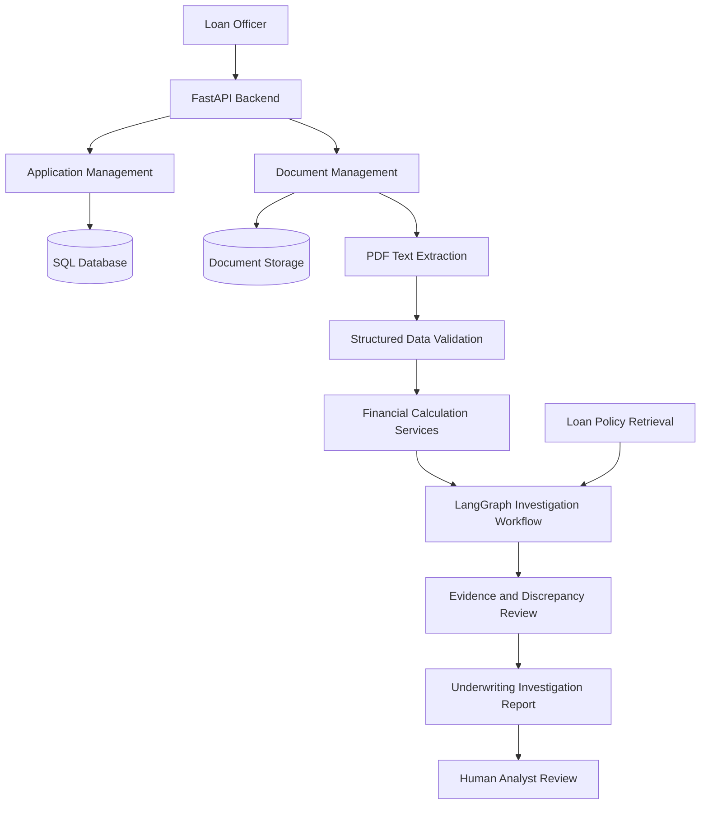
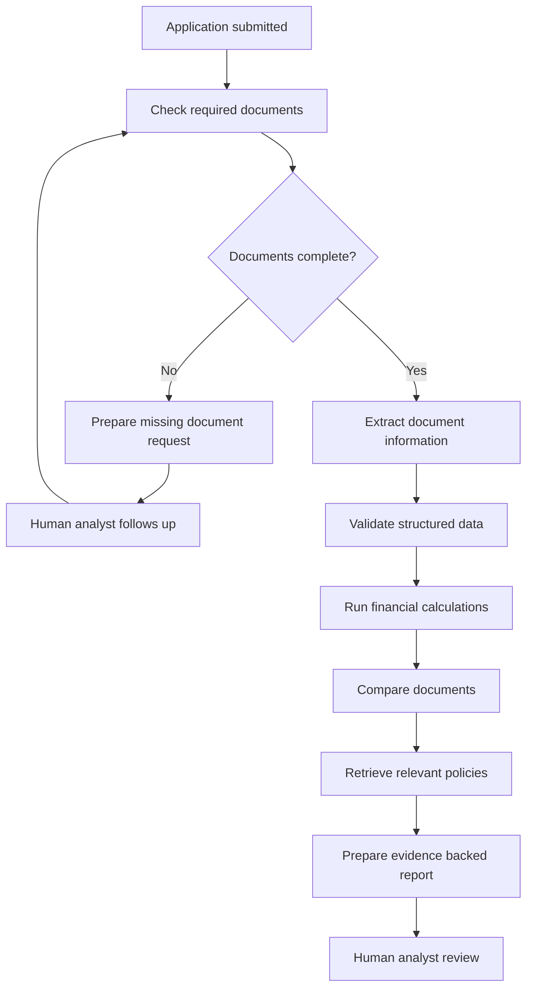

# AI Loan Underwriting Investigation Assistant

**An AI powered assistant that helps lending teams review loan applications, examine supporting documents, identify inconsistencies, and prepare evidence backed underwriting reports.**

> **Project status: In development.** This repository is an early backend prototype. The application management and database foundation are being built first. Document ingestion, AI analysis, and the agent workflow are planned next. This README distinguishes current implementation from the intended product so that the project scope is clear.

## 1. Overview

Loan underwriting is the process a lender uses to assess whether a loan applicant appears able to repay a requested loan and whether the application meets the lender's policies.

A lending analyst may need to review several documents before preparing an assessment:

- **Loan application:** The applicant's details, requested loan amount, and loan purpose.
- **Payslips:** Evidence of employment income and salary deductions.
- **Bank statements:** Records of money credited to and debited from the applicant's bank account. These help an analyst understand actual cash flow and recurring commitments.
- **Existing loan statements:** Details of current loans, outstanding balances, monthly instalments, and repayment activity, where applicable.
- **Other supporting evidence:** Additional documents requested by the lender when the submitted information is incomplete or inconsistent.

Reviewing these documents manually can take time. Information may be spread across several files, a value in one document may not match another, and analysts may need to follow up for missing evidence.

The AI Loan Underwriting Investigation Assistant is intended to support that investigation process. It brings application information and supporting documents into one workflow, extracts relevant facts, performs rule based calculations, highlights discrepancies, and prepares a report for a human loan analyst.

**The product is decision support, not an autonomous lending decision maker.** A qualified human reviewer remains responsible for the final lending decision.

## 2. The Problem

Loan operations teams regularly need to:

1. Review multiple documents for each application.
2. Find income, deductions, expenses, existing loan instalments, and other relevant information.
3. Compare information across documents to identify mismatches.
4. Work out whether the application contains enough evidence for assessment.
5. Contact the applicant or relationship manager when information is missing.
6. Record the findings and explain why an application needs further review.

These tasks are repetitive and document heavy. They are also consequential: an incorrect extraction or unsupported conclusion can affect a customer's access to credit.

The opportunity is to reduce manual document handling while making the review process more consistent, traceable, and easier for an analyst to inspect.

## 3. Proposed Solution

The application is designed as an AI investigation assistant for loan operations and underwriting teams.

An employee creates a loan application and attaches the available supporting documents. The system will then:

1. Extract text and relevant fields from the uploaded documents.
2. Convert extracted information into validated structured data.
3. Calculate financial metrics using deterministic Python functions.
4. Compare related values across documents.
5. Identify missing information and potential inconsistencies.
6. Retrieve relevant lender policy information when configured.
7. Prepare an evidence backed underwriting investigation report.
8. Allow the employee to review the findings and request more information where needed.

The AI should explain which document and extracted value support each finding. It should identify uncertainty rather than invent information when a document is unclear or data is missing.

## 4. Example User Journey

The intended user is a loan officer or underwriting analyst.

### Step 1: Create an application

The employee creates an application with basic information such as the applicant's name, requested loan amount, and loan purpose.

### Step 2: Attach supporting documents

The employee uploads the documents available for the application. The initial document categories are:

| Document type | What it helps verify |
|---|---|
| Payslip | Salary, gross income, deductions, and net salary |
| Bank statement | Salary credits, regular expenses, cash flow, and visible loan instalments |
| Existing loan statement | Outstanding balance, monthly instalment, loan details, and repayment activity |
| Other supporting document | Additional evidence requested during an investigation |

The exact document requirements and review period should be configurable by the lender and loan product. The project will not assume that every applicant has an existing loan.

### Step 3: Extract and organize information

The system reads the documents and extracts relevant fields. Extracted values are stored in a structured format with references to their source document and, where practical, the page or text location from which they came.

### Step 4: Analyze and cross check

The system uses ordinary application code for calculations and validation. For example, it can compare salary reported on a payslip with recurring salary credits found in a bank statement. It can also identify existing instalments and calculate configured repayment metrics.

### Step 5: Request additional information

If a required document is missing or an inconsistency cannot be resolved from the submitted evidence, the system can show the analyst what is needed and why. The analyst can request the document from the applicant through the lender's existing process and attach it to the application when received.

### Step 6: Review the investigation report

The assistant prepares a report containing extracted facts, calculations, missing evidence, discrepancies, policy references when available, and suggested follow up actions. The analyst checks the evidence and decides what action to take.

## 5. Product Principles

### Human oversight

The system supports the analyst. It does not independently approve or reject a loan, change a customer's credit limit, or freeze an account.

### Evidence before conclusions

Important findings should link back to the document and extracted information that support them. The system should distinguish verified facts, calculated values, model generated explanations, and unresolved questions.

### Deterministic financial calculations

The language model should not be trusted to perform financial arithmetic. Calculations such as totals, recurring payment amounts, debt obligations, and configured repayment ratios should be implemented and tested in Python.

### Configurable lender requirements

Document requirements and underwriting policies vary by lender, product, and jurisdiction. They should become configuration and policy data rather than being permanently hard coded into prompts.

### Privacy by design

Financial documents contain sensitive personal and financial information. The intended design is to keep original documents in controlled storage, minimize the information sent to an external model, protect secrets, and support private deployment options for institutions that require them.

## 6. High Level Architecture

The backend is being built as a modular FastAPI application. The database and model provider are configured separately so that the project can evolve without coupling business logic to SQLite or one LLM provider.



The diagram describes the target workflow. Not every component has been implemented yet.

### Backend components

| Component | Responsibility |
|---|---|
| FastAPI | Exposes HTTP endpoints and API documentation |
| SQLAlchemy | Maps Python models to relational database tables |
| Alembic | Tracks and applies database schema changes |
| SQLite | Local development database for the current prototype |
| PostgreSQL | Intended alternative database for a later deployment |
| Pydantic | Validates incoming API data and structured extraction results |
| PyMuPDF | Intended PDF text extraction component |
| LangChain | Provides model and tool integrations |
| LangGraph | Intended orchestration layer for the multi step investigation workflow |
| Gemini | Initial LLM provider for experimentation |
| `uv` | Python project, dependency, environment, and command management |

## 7. Technology Stack

| Technology | Why it is used |
|---|---|
| Python | Main backend language |
| FastAPI | API framework with automatic OpenAPI documentation |
| SQLAlchemy | Database access through Python models rather than SQLite specific query code |
| SQLite | Simple local database for development |
| Alembic | Versioned database migrations |
| Pydantic and Pydantic Settings | Data validation and environment based configuration |
| LangChain | Common interface for LLMs and tools |
| LangGraph | Stateful agent workflow orchestration |
| `langchain-google-genai` | Gemini integration for the initial implementation |
| PyMuPDF | PDF text extraction |
| `python-multipart` | Multipart form data and file upload support |
| `uv` | Dependency installation, lockfile management, and execution |

### Model agnostic design

Gemini is the initial model provider, not a permanent architectural dependency. LLM initialization will be isolated behind a small model factory or provider configuration. The investigation workflow should depend on a common model interface rather than calling Gemini specific APIs throughout the business logic.

Changing the provider may still require installing its LangChain integration, configuring credentials, and testing model behavior. A provider change is not guaranteed to be only a configuration change in every case.

### Database portability

The application uses SQLAlchemy for relational database access. The current development database is SQLite. PostgreSQL can be introduced by changing the database URL and adding the PostgreSQL driver, then validating migrations and database specific behavior. Existing data will need to be migrated separately when moving databases; changing the URL alone does not transfer data.

## 8. Current Data Model

The initial relational model contains two main entities.

### `loan_applications`

Stores the basic information for a loan application.

| Field | Purpose |
|---|---|
| `id` | Unique application identifier |
| `applicant_name` | Applicant name |
| `requested_loan_amount` | Amount requested by the applicant |
| `loan_purpose` | Reason for the loan |
| `status` | Current application status, initially `documents_pending` |
| `created_at` | Application creation timestamp |

### `documents`

Stores metadata about each document associated with an application. The actual document file is intended to be stored separately from the relational database.

| Field | Purpose |
|---|---|
| `id` | Unique document identifier |
| `application_id` | Foreign key to the related loan application |
| `document_type` | Type of document, such as payslip or bank statement |
| `original_filename` | Name supplied for the uploaded file |
| `storage_path` | Location of the stored file |
| `file_size` | File size in bytes |
| `created_at` | Upload record creation timestamp |

One application can have multiple documents. The `application_id` foreign key represents this relationship.

The schema is expected to evolve as the project adds extraction results, document review status, investigation findings, policy versions, and audit records. Database changes should be made through Alembic migrations.

## 9. API Overview

The first API group manages loan applications.

| Method | Endpoint | Purpose |
|---|---|---|
| `POST` | `/api/v1/applications/` | Create a loan application |
| `GET` | `/api/v1/applications/` | List loan applications |
| `GET` | `/api/v1/applications/{application_id}` | Retrieve one application |
| `PATCH` | `/api/v1/applications/{application_id}` | Update supplied application fields |
| `DELETE` | `/api/v1/applications/{application_id}` | Delete an application in the current prototype |

The document database model is being established. Document upload, validation, extraction, and the related API workflow are the next implementation steps and should not be considered complete until they are present and tested in the repository.

## 10. Example API Request

Create an application:

**`POST /api/v1/applications/`**

```json
{
  "applicant_name": "Rahul Sharma",
  "requested_loan_amount": 500000,
  "loan_purpose": "Personal loan"
}
```

The API validates the incoming payload, creates a SQLAlchemy model instance, saves it through a database session, and returns the stored application.

## 11. Local Development Setup

### Prerequisites

- Python version supported by the project's `pyproject.toml`
- `uv`
- Git

### Clone the repository

```bash
git clone <repository-url>
cd loan-underwriting
```

### Install dependencies

```bash
uv sync
```

`uv sync` installs dependencies declared in `pyproject.toml` and uses `uv.lock` to keep the environment reproducible.

### Configure environment variables

Create a `.env` file in the project root:

```env
DATABASE_URL=sqlite:///./data/loan_underwriting.db
GOOGLE_API_KEY=your_gemini_api_key
LLM_PROVIDER=google_genai
LLM_MODEL=gemini-2.5-flash
```

The database URL is used by the SQLAlchemy database configuration. The LLM settings are intended for the upcoming model integration. Do not commit `.env` or real API keys to source control. Keep a `.env.example` file with placeholder values.

Create the local data directory if it does not exist:

```bash
mkdir -p data/uploads
```

### Apply database migrations

After the Alembic configuration and initial migration are present in the repository, create or update the local database with:

```bash
uv run alembic upgrade head
```

When a SQLAlchemy model changes, generate a migration, review the generated file, and then apply it:

```bash
uv run alembic revision --autogenerate -m "describe the schema change"
uv run alembic upgrade head
```

Autogenerated migrations should always be reviewed before they are applied. Alembic compares model metadata with the current database; it does not guarantee that every intended change is detected correctly.

### Run the API

```bash
uv run uvicorn app.main:app --reload
```

The development server is available at:

- API root: `http://127.0.0.1:8000/`
- Health check: `http://127.0.0.1:8000/health`
- Interactive API documentation: `http://127.0.0.1:8000/docs`
- OpenAPI schema: `http://127.0.0.1:8000/openapi.json`

The application startup check verifies database connectivity. Table creation and schema updates are performed through Alembic migrations, not automatically by starting FastAPI.

### Verify payslip and bank statement

Use the existing document extraction endpoints in Swagger (`/docs`) to extract and save one payslip and one bank statement for the same application:

- `POST /api/v1/applications/{application_id}/documents/{document_id}/analyze-payslip`
- `POST /api/v1/applications/{application_id}/documents/{document_id}/analyze-bank-statement`
- `POST /api/v1/applications/{application_id}/analyze-bank-statement?document_id={document_id}` (document_id is optional)

Then call `POST /api/v1/applications/{application_id}/verify-finances`. The response compares the saved extractions, reports salary and name findings, and checks transaction totals, statement balance reconciliation, and available running balances. It uses the most recently uploaded document of each type that has a matching saved extraction. Missing extraction data returns `422`; an unknown application returns `404`.

The verification uses deterministic Python logic and does not call an LLM or make a lending decision. Salary amounts are not treated as salary evidence on their own when the transaction description does not support that identification.

The bank-statement `total_credits` and `total_debits` findings compare the sums of transaction rows against the totals explicitly extracted from the statement summary. The extraction prompt does not ask the model to calculate statement totals. If those summary totals are not printed or extracted, the corresponding check is `needs_review`.

The analyze-bank-statement endpoint also classifies every transaction deterministically and returns each original transaction with a category and classification reason. When a saved extraction exists, the endpoint reuses its structured JSON and does not reopen the PDF or call the LLM again. Classification is saved separately as the `bank_transaction_classification` extraction type, keyed by zero-based transaction index; it does not modify the original extraction. Existing classification records are reused when complete or updated in place when they need regeneration. Ambiguous credits and debits are returned as `other_uncertain`.

The application-level bank-statement endpoint automatically selects the only bank statement uploaded for that application. If multiple statements exist, Swagger returns `409` until `document_id` is specified; if none exist, it returns `404`. In `/docs`, call `POST /api/v1/applications/{application_id}/analyze-bank-statement` first without `document_id` to try automatic selection, then again with the optional query parameter populated to select a specific statement. The existing document-level endpoint remains available.

For an uploaded `existing_loan_statement` document, call `POST /api/v1/applications/{application_id}/documents/{document_id}/analyze-loan-statement` in Swagger. The endpoint extracts explicitly stated loan and repayment details, caches the result as `loan_statement`, and returns the cached extraction on repeated requests.

Financial calculation runs are stored separately from document extractions in `financial_analyses`. Apply the schema with `uv run alembic upgrade head`. The calculation service can persist a completed run with `save_financial_analysis`; Decimal values are stored as decimal strings in JSON to preserve precision. Retrieve the latest saved run with `GET /api/v1/applications/{application_id}/financial-analyses/latest`. A financial-calculation endpoint is not yet implemented, so this release provides persistence and retrieval but does not create analysis runs itself.

## 12. Planned AI Investigation Workflow

The following is the intended AI workflow. It is a roadmap, not a claim that all these capabilities are already implemented.

### Document extraction

PDF files will be processed to extract text. Extracted text will be converted into structured fields using Pydantic validated outputs. The system should retain the source document and page context for important extracted values.

### Financial analysis

Python services will perform calculations such as:

- Monthly income summaries
- Recurring expense and obligation summaries
- Existing monthly loan instalments
- Configured debt to income or repayment burden metrics
- Cash flow summaries over the available statement period

The exact formulas and thresholds must be configurable and validated with lending domain experts. A metric alone should not be treated as a lending decision.

### Cross document verification

The system will compare relevant facts across documents. Examples include:

- Whether salary information in payslips is consistent with salary credits in bank statements
- Whether recurring loan instalments appear in bank activity
- Whether the applicant's declared liabilities are consistent with available loan statements
- Whether dates, amounts, or names conflict across submitted documents

A mismatch is an investigation signal, not proof of fraud. The system should show the evidence and allow an analyst to resolve it.

### Policy retrieval

A retrieval component may make lender approved policy documents searchable. The agent can use the retrieved policy passages to explain which requirements appear relevant. Policy version and source references should be retained so an analyst can verify them.

### Additional document requests

If evidence is missing or unclear, the system can recommend a specific follow up request. For example, if the salary credited to the bank account differs from the payslip amount, the assistant may suggest that the analyst request clarification or a supporting salary revision document.

The analyst remains in control of whether the request is sent and how the applicant is contacted.

### Investigation report

The final report is expected to include:

1. Application summary
2. Documents received and documents still required
3. Extracted financial facts with source references
4. Deterministic calculations and assumptions
5. Cross document discrepancies
6. Relevant policy references, if configured
7. Unresolved questions and recommended follow up
8. A clear human review section

## 13. LangGraph Agent Design

LangGraph is intended to coordinate the multi step investigation workflow. A possible workflow is:



The workflow is intended to use explicit state, structured inputs and outputs, bounded retries, and human review checkpoints. The model should not be allowed to make uncontrolled changes to application records or trigger consequential lending actions.

## 14. Privacy, Security, and Responsible Use

Financial documents contain personal information and sensitive financial data. A production deployment would require security, compliance, and operational controls beyond the current local prototype.

The intended approach includes:

- Store original documents in access controlled storage.
- Encrypt data in transit and at rest.
- Apply role based access controls for employees.
- Keep an audit trail of document access, extraction, model activity, and human decisions.
- Minimize personal information sent to an external LLM.
- Redact direct identifiers when they are not required for a task.
- Use enterprise model arrangements or private deployment where the lender's risk and compliance requirements demand them.
- Define retention, deletion, backup, and incident response policies.
- Validate model outputs and calculations before presenting them as findings.
- Keep final underwriting decisions with authorized human reviewers.

**Current prototype limitations:** Authentication, authorization, tenant isolation, production encryption, malware scanning, formal audit logging, data retention controls, and private model deployment are not yet implemented. Do not use real customer financial documents with this development version. Use synthetic or properly anonymized sample data only.

The appropriate regulatory and contractual requirements depend on the lender, its role, the deployment model, and the jurisdiction. Any real deployment must be reviewed by qualified legal, compliance, information security, and lending operations teams.

## 15. Roadmap

### Phase 1: Backend foundation

- [x] Initialize the project with `uv`
- [x] Set up FastAPI application
- [x] Configure SQLAlchemy with SQLite
- [x] Configure Alembic migrations
- [x] Create the initial loan application model
- [x] Add basic loan application create, read, update, and delete endpoints
- [x] Define the document model and its relationship to an application

### Phase 2: Document management

- [ ] Implement PDF upload endpoint
- [ ] Validate file type and size
- [ ] Store files separately from relational database records
- [ ] Save document metadata in the database
- [ ] Add document listing and checklist endpoints
- [ ] Support additional document requests and resubmissions

### Phase 3: Document understanding

- [ ] Extract PDF text with PyMuPDF
- [ ] Define Pydantic schemas for extracted financial information
- [ ] Integrate the initial Gemini model through LangChain
- [ ] Add extraction validation and error handling
- [ ] Preserve document and page level evidence references

### Phase 4: Underwriting investigation agent

- [ ] Implement deterministic financial calculation services
- [ ] Add cross document consistency checks
- [ ] Add lender policy retrieval
- [ ] Build the LangGraph investigation workflow
- [ ] Add human review and additional information checkpoints
- [ ] Generate structured investigation reports

### Phase 5: Product readiness

- [ ] Build the analyst dashboard
- [ ] Add authentication and role based access control
- [ ] Add tenant isolation and audit logging
- [ ] Add secure document storage and retention controls
- [ ] Evaluate extraction accuracy and investigation quality
- [ ] Validate with lending professionals using synthetic or authorized data
- [ ] Explore PostgreSQL and private deployment options

## 16. Evaluation Plan

A credible underwriting assistant must be measured on more than whether its output sounds convincing. Planned evaluation should include:

| Area | Example measurement |
|---|---|
| Document extraction | Field level accuracy against a labeled test set |
| Evidence quality | Percentage of material findings linked to a valid source |
| Financial calculations | Agreement with independently tested Python calculations |
| Discrepancy detection | Precision and recall against labeled inconsistencies |
| Missing document detection | Accuracy of required document checklist results |
| Reliability | Workflow completion rate and recoverability from tool failures |
| Efficiency | Analyst review time and processing time per application |
| Cost | Model and infrastructure cost per processed application |

Evaluation datasets should use synthetic or properly authorized data. Test cases should include missing pages, low quality scans, inconsistent values, duplicate documents, and ambiguous information.

## 17. Business Opportunity

The initial target users are organizations that process personal loan applications and have document intensive underwriting or loan operations workflows. Potential customers include NBFCs, digital lending companies, and lending operations teams.

The product hypothesis is that these teams may benefit from reducing repetitive document review and follow up work while making the investigation trail easier to inspect.

Potential commercial models to validate include:

- Usage based pricing per application processed
- Subscription pricing for an underwriting team
- Enterprise licensing with private cloud or customer controlled deployment
- Integration and implementation services for existing lending systems

These are hypotheses, not validated pricing or evidence of market demand. Before building a full platform, the project should be tested with underwriters and lending operations professionals to understand their current process, systems, compliance constraints, and highest cost manual tasks.

## 18. Scope and Non Goals

The initial prototype is focused on document review and investigation support.

It is **not** intended to:

- Replace a lender's core loan origination or loan management system
- Make final credit approval or rejection decisions autonomously
- Guarantee fraud detection
- Replace credit bureaus or official verification services
- Provide financial, legal, or credit advice to applicants
- Process real customer data before appropriate security and compliance controls exist

## 19. Contributing and Development Notes

The project is under active development. Changes should be kept small and independently testable.

- Use `uv add <package>` to add runtime dependencies.
- Use `uv add --dev <package>` to add development dependencies.
- Use `uv run <command>` to execute project tools and Python commands.
- Keep `uv.lock` committed so installs are reproducible.
- Keep secrets in `.env`; commit only `.env.example` with placeholder values.
- Use Alembic migrations for database schema changes. Review autogenerated migrations before applying them.
- Keep financial calculations in ordinary Python services, not in LLM prompts.
- Keep model provider specific code behind a dedicated integration layer.

## 20. Project Structure

The initial backend uses a simple package layout. Directories will gain files as features are implemented.

```text
loan-underwriting/
├── app/
│   ├── __init__.py
│   ├── main.py                 # FastAPI application and startup lifecycle
│   ├── api/                    # HTTP routes
│   ├── db/                     # SQLAlchemy engine, base, and sessions
│   ├── models/                 # SQLAlchemy database models
│   ├── schemas/                # Pydantic request and response schemas
│   ├── services/               # Business logic and document processing
│   └── ai/                     # LLM provider integration and prompts
├── migrations/                 # Alembic configuration and migration history
├── data/
│   └── uploads/                # Local development document storage
├── .env                        # Local secrets and configuration, not committed
├── .env.example                # Configuration template, safe to commit
├── .gitignore
├── alembic.ini
├── pyproject.toml
└── uv.lock
```

## 21. Disclaimer

This repository is an experimental software prototype. It is not a certified lending, credit scoring, fraud detection, or regulatory compliance system. Its outputs must not be used as the sole basis for a lending decision. Any real world use requires appropriate validation, security controls, lender policy configuration, human oversight, and legal and regulatory review.

---

**Project:** AI Loan Underwriting Investigation Assistant  
**Status:** In development  
**Backend:** FastAPI, SQLAlchemy, Alembic, SQLite, LangChain, LangGraph  
**Package management:** `uv`
